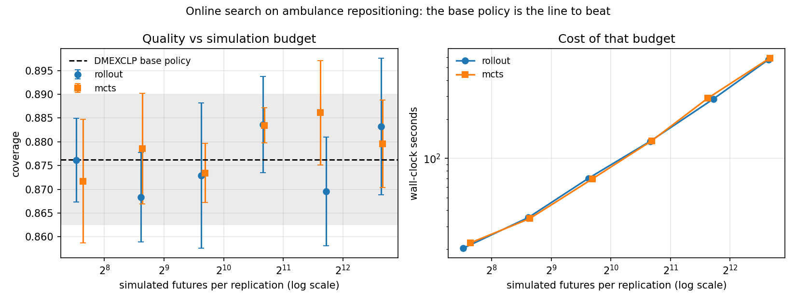

# Ambulance Dispatch and Repositioning

AI course project (Assignment 2) — Anuj Trivedi, B23CH1006, IIT Jodhpur.

Emergency calls arrive stochastically across a city road network. A fleet of ambulances
must serve them, and an agent makes two coupled decisions:

- **Dispatch** — when a call comes in, which available unit to send (or whether to let it wait).
- **Repositioning** — where each idle unit should wait, re-decided as the fleet state changes.

The two conflict. Sending the nearest unit is optimal for the call in front of you, but it
can strip cover from a dense zone and cost the next call far more than it saved this one.
The project builds a simulation testbed for that trade-off and compares classical
heuristics, online search, and learned policies on it.

See [ROADMAP.md](ROADMAP.md) for the formulation, the phase plan, and the decision log.

## Model

Decisions occur only at event epochs, so the problem is modelled as a **semi-Markov
decision process** over a discrete-event simulation:

| | |
|---|---|
| State | time, per-unit (status, position, ETA), queue of unserved calls |
| Action | which unit to dispatch; which base an idle unit drives to |
| Stochasticity | time-varying Poisson arrivals, spatial demand hotspots, noisy travel times, random on-scene durations |
| Objective | maximise calls reached within 8 minutes; report mean/p90 response time and worst-zone coverage |

## Quick start

```bash
pip install -r requirements.txt
python scripts/run_baseline.py --days 7 --reps 10
python scripts/run_phase2.py --days 7 --reps 30
python scripts/run_phase3.py --methods rollout --budgets 1,4,16
python -m pytest tests -q
```

## Current results

8x8 grid city, 4 stations, 6 ambulances, 4 calls/hour, 7 simulated days x 30 paired
replications (~648 calls per replication):

| policy | coverage (≤8 min) | mean response | p90 response | worst-zone coverage |
|---|---|---|---|---|
| B0 random (floor) | 0.357 | 10.09 min | 16.21 min | 0.282 |
| B1 nearest-idle, hand-placed stations | 0.765 | 5.82 min | 11.72 min | 0.727 |
| B2a nearest-idle, p-median stations | 0.858 | **4.67 min** | 9.73 min | 0.792 |
| B2b nearest-idle, MEXCLP stations | 0.860 | 5.38 min | 9.14 min | 0.798 |
| B3 DMEXCLP on MEXCLP stations | **0.872** | 5.26 min | **8.81 min** | **0.822** |
| B3h DMEXCLP on hand-placed stations | 0.836 | 5.07 min | 10.31 min | 0.711 |

B3 beats B1 on all four metrics, every one significant at 5% on both a paired t-test and
Wilcoxon signed-rank (n = 30). The interesting part is the decomposition:

- **Station placement does most of the work.** B1→B2b is +0.096 coverage; adding dynamic
  repositioning on top (B2b→B3) adds only +0.012. Repositioning on *badly placed* stations
  (B1→B3h) is worth +0.071 on its own — so the two are largely substitutes, and a large
  reported DMEXCLP gain is implicitly a report of badly-placed stations.
- **DMEXCLP trades equity for the average.** B3h lifts city-wide coverage by +0.071 while
  *lowering* worst-zone coverage by 0.016 (p ≈ 0.08 — a hint, not yet a result). Its
  objective has no term for the worst-off zone. Phase 5 picks this up.
- **p-median and MEXCLP optimise different things**, exactly as theory says: p-median wins
  the mean (4.67 min), MEXCLP wins the tail and coverage (p90 9.14 min).

Reproduce with `python scripts/run_phase2.py --reps 30 --days 7`.

### Phase 3: online search does not pay here

Rollout and MCTS both estimate the value of a repositioning action by simulating sampled
futures under DMEXCLP. Across budgets from 1 to 64 simulated futures per decision, neither
beat the base policy they were rolling out, on any metric, at any budget — and the curve is
*flat*, so 32x more simulation bought nothing measurable:

| policy | coverage | mean response | cost vs base |
|---|---|---|---|
| DMEXCLP base | 0.876 | 5.08 min | 1x |
| rollout m=1 | 0.876 | 5.26 min | 84x |
| rollout m=8 | 0.884 | 5.22 min | 867x |
| rollout m=32 | 0.883 | 5.25 min | 3400x |
| MCTS n=2 | 0.872 | 5.27 min | 98x |
| MCTS n=32 | 0.886 | 5.21 min | 1545x |
| MCTS n=64 | 0.880 | 5.26 min | 3460x |

A confirmation run at 20 replications x 3 days
(`python scripts/run_phase3.py --methods rollout --budgets 8 --reps 20 --days 3`) makes this
a real null rather than a weak test: coverage differs by -0.001 with a 95% CI of
[-0.008, +0.006], tight enough to exclude an effect the size of DMEXCLP's own Phase 2 gain
(+0.012). **Why** is measurable directly: the coverage difference between the top candidate
stations is about 0.005, while the paired standard deviation across sampled futures is
about 0.035 even with common random numbers. Resolving that needs ~200 simulated futures
per candidate per decision, against the 1–32 that are affordable. The search is overriding
a base-policy ranking that carries real information, using an estimate that is mostly noise.

The same run found something sharper. Rollout is **significantly worse on mean response**
(+0.077 min, p = 0.004, d = 0.73), and every one of the twelve search configurations leans
the same way while coverage scatters with no direction. The mechanism is the value function,
not the search: scoring the binary 8-minute indicator makes the agent completely indifferent
between a 3-minute and a 7-minute response, so it trades fast responses away for nothing.
On this problem, reward design mattered more than search depth.



Reproduce with `python scripts/run_phase3.py --methods rollout --out results/phase3_rollout.csv`
(and `--methods mcts`), then `python scripts/plot_phase3.py results/phase3_*.csv`.

## Layout

```
src/ambulance/
  city.py            road graph, travel times, demand model, call generation
  sim.py             discrete-event simulator and ambulance state machine
  location.py        static station placement: p-median and MEXCLP
  metrics.py         response-time, coverage and equity metrics
  experiment.py      paired, seeded replications
  stats.py           paired t + Wilcoxon significance testing
  policies/          one Policy interface, every method behind it
    nearest.py       B1 nearest-idle, and a random floor
    coverage.py      B3 DMEXCLP dynamic repositioning
    rollout.py       one-step lookahead with Monte Carlo rollout
    mcts.py          open-loop MCTS over repositioning sequences
scripts/run_baseline.py   Phase 1 reference policies
scripts/run_phase2.py     station optimisation + dynamic repositioning
scripts/run_phase3.py     online search, budget sweep
scripts/plot_phase3.py    the anytime curve
tests/
```
