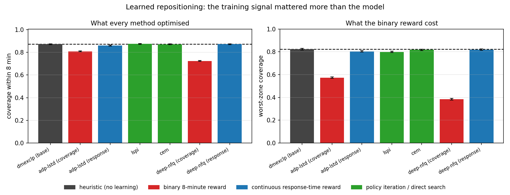
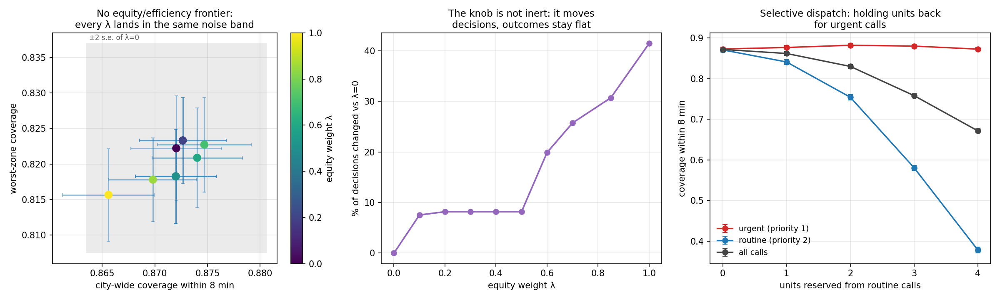
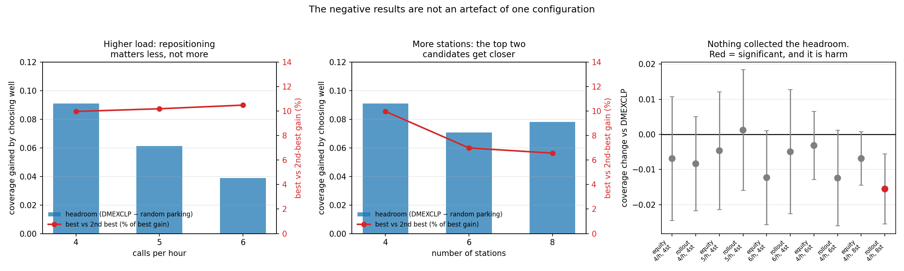

# Ambulance Dispatch and Repositioning

AI course project (Assignment 2) — Anuj Trivedi, B23CH1006, IIT Jodhpur.

Emergency calls arrive stochastically across a city road network. A fleet of ambulances
must serve them, and an agent makes two coupled decisions:

- **Dispatch** — when a call comes in, which available unit to send (or whether to let it wait).
- **Repositioning** — where each idle unit should wait, re-decided as the fleet state changes.

The two conflict. Sending the nearest unit is optimal for the call in front of you, but it
can strip cover from a dense zone and cost the next call far more than it saved this one.
The project builds a simulation testbed for that trade-off and compares classical
heuristics, online search, and learned policies on it.

See [ROADMAP.md](ROADMAP.md) for the formulation, the phase plan, and the decision log.

## Model

Decisions occur only at event epochs, so the problem is modelled as a **semi-Markov
decision process** over a discrete-event simulation:

| | |
|---|---|
| State | time, per-unit (status, position, ETA), queue of unserved calls |
| Action | which unit to dispatch; which base an idle unit drives to |
| Stochasticity | time-varying Poisson arrivals, spatial demand hotspots, noisy travel times, random on-scene durations |
| Objective | maximise calls reached within 8 minutes; report mean/p90 response time and worst-zone coverage |

## Quick start

```bash
pip install -r requirements.txt
python scripts/run_baseline.py --days 7 --reps 10
python scripts/run_phase2.py --days 7 --reps 30
python scripts/run_phase3.py --methods rollout --budgets 1,4,16
python scripts/run_phase4.py --reps 30 --days 7
python scripts/run_phase5.py --reps 30 --days 7
python -m pytest tests -q
```

## Current results

8x8 grid city, 4 stations, 6 ambulances, 4 calls/hour, 7 simulated days x 30 paired
replications (~648 calls per replication):

| policy | coverage (≤8 min) | mean response | p90 response | worst-zone coverage |
|---|---|---|---|---|
| B0 random (floor) | 0.357 | 10.09 min | 16.21 min | 0.282 |
| B1 nearest-idle, hand-placed stations | 0.765 | 5.82 min | 11.72 min | 0.727 |
| B2a nearest-idle, p-median stations | 0.858 | **4.67 min** | 9.73 min | 0.792 |
| B2b nearest-idle, MEXCLP stations | 0.860 | 5.38 min | 9.14 min | 0.798 |
| B3 DMEXCLP on MEXCLP stations | **0.872** | 5.26 min | **8.81 min** | **0.822** |
| B3h DMEXCLP on hand-placed stations | 0.836 | 5.07 min | 10.31 min | 0.711 |

B3 beats B1 on all four metrics, every one significant at 5% on both a paired t-test and
Wilcoxon signed-rank (n = 30). The interesting part is the decomposition:

- **Station placement does most of the work.** B1→B2b is +0.096 coverage; adding dynamic
  repositioning on top (B2b→B3) adds only +0.012. Repositioning on *badly placed* stations
  (B1→B3h) is worth +0.071 on its own — so the two are largely substitutes, and a large
  reported DMEXCLP gain is implicitly a report of badly-placed stations.
- **DMEXCLP trades equity for the average.** B3h lifts city-wide coverage by +0.071 while
  *lowering* worst-zone coverage by 0.016 (p ≈ 0.08 — a hint, not yet a result). Its
  objective has no term for the worst-off zone. Phase 5 picks this up.
- **p-median and MEXCLP optimise different things**, exactly as theory says: p-median wins
  the mean (4.67 min), MEXCLP wins the tail and coverage (p90 9.14 min).

Reproduce with `python scripts/run_phase2.py --reps 30 --days 7`.

### Phase 3: online search does not pay here

Rollout and MCTS both estimate the value of a repositioning action by simulating sampled
futures under DMEXCLP. Across budgets from 1 to 64 simulated futures per decision, neither
beat the base policy they were rolling out, on any metric, at any budget — and the curve is
*flat*, so 32x more simulation bought nothing measurable:

| policy | coverage | mean response | cost vs base |
|---|---|---|---|
| DMEXCLP base | 0.876 | 5.08 min | 1x |
| rollout m=1 | 0.876 | 5.26 min | 84x |
| rollout m=8 | 0.884 | 5.22 min | 867x |
| rollout m=32 | 0.883 | 5.25 min | 3400x |
| MCTS n=2 | 0.872 | 5.27 min | 98x |
| MCTS n=32 | 0.886 | 5.21 min | 1545x |
| MCTS n=64 | 0.880 | 5.26 min | 3460x |

A confirmation run at 20 replications x 3 days
(`python scripts/run_phase3.py --methods rollout --budgets 8 --reps 20 --days 3`) makes this
a real null rather than a weak test: coverage differs by -0.001 with a 95% CI of
[-0.008, +0.006], tight enough to exclude an effect the size of DMEXCLP's own Phase 2 gain
(+0.012). **Why** is measurable directly: the coverage difference between the top candidate
stations is about 0.005, while the paired standard deviation across sampled futures is
about 0.035 even with common random numbers. Resolving that needs ~200 simulated futures
per candidate per decision, against the 1–32 that are affordable. The search is overriding
a base-policy ranking that carries real information, using an estimate that is mostly noise.

The same run found something sharper. Rollout is **significantly worse on mean response**
(+0.077 min, p = 0.004, d = 0.73), and every one of the twelve search configurations leans
the same way while coverage scatters with no direction. The mechanism is the value function,
not the search: scoring the binary 8-minute indicator makes the agent completely indifferent
between a 3-minute and a 7-minute response, so it trades fast responses away for nothing.
On this problem, reward design mattered more than search depth.


Reproduce with `python scripts/run_phase3.py --methods rollout --out results/phase3_rollout.csv`
(and `--methods mcts`), then `python scripts/plot_phase3.py results/phase3_*.csv`.

### Phase 4: learning matched the heuristic, and the reward decided everything

Six learned policies, one feature set, one simulator. 30 paired replications x 7 days,
trained on disjoint call-stream seeds:

| policy | coverage | mean response | worst-zone | vs DMEXCLP |
|---|---|---|---|---|
| DMEXCLP heuristic | 0.872 | 5.26 min | 0.822 | — |
| ADP-LSTD, binary reward | 0.809 | 5.78 min | 0.573 | **−0.063** coverage |
| ADP-LSTD, continuous reward | 0.861 | 5.50 min | 0.804 | −0.011 |
| LSPI | 0.875 | **5.22 min** | 0.798 | +0.003 (n.s.) |
| CEM direct policy search | 0.871 | 5.30 min | 0.817 | −0.001 (n.s.) |
| Deep NFQ, binary reward | 0.724 | 6.60 min | 0.384 | **−0.148** coverage |
| Deep NFQ, continuous reward | 0.872 | 5.26 min | 0.819 | +0.000 (n.s.) |

**No learned policy beat the heuristic.** The best of them — a neural value network on a
continuous reward — ties it on every metric to three decimal places (p = 0.91, 0.93, 0.52).
LSPI buys a small but real mean-response win (−0.047 min, p = 0.004) and pays for it in
equity (−0.024 worst-zone, p = 0.003).

The reason is diagnosable rather than mysterious. Greedy on the expected-covered-demand
feature is *algebraically identical* to DMEXCLP, and scores identically to nine decimal
places — so the hypothesis class provably contains the heuristic, and a hand-set
"coverage − distance" weighting beats it. Every value-fitting method nonetheless lands
below: **LSTD, LSPI and NFQ all fit value prediction, and the directions an action can move
the state contribute almost nothing to prediction error**, which is dominated by exogenous
call variation. The fit has no incentive to rank actions correctly, so it doesn't. Adding
capacity made this worse, not better — the network fits the exogenous noise faster.

**The training signal mattered far more than the model.** Switching the reward from the
binary 8-minute indicator to continuous response time is worth +0.052 coverage for the
linear model and +0.148 for the network — larger than any architectural choice in the
table. This is Phase 3's finding in a different algorithm, which makes it the spine of the
project: a reward that cannot tell a 3-minute response from a 7-minute one starves
learning of gradient.

The binary reward's **equity damage** is worse than its coverage damage: worst-zone
coverage collapses from 0.822 to 0.384 (p < 1e-28). Maximising a count of indicators is
maximised by serving dense zones and abandoning the sparse one, which is exactly what the
agent learned to do. Phases 2, 3 and 4 all converge on the same lesson from different
directions.



Reproduce with `python scripts/run_phase4.py --reps 30 --days 7 --out-csv results/phase4.csv`,
then `python scripts/plot_phase4.py results/phase4.csv`.

### Phase 5: one trade-off is real and badly priced, the other does not exist

**Selective dispatch.** Holding units back from routine calls to stay ready for urgent
ones does work — and costs far more than it buys:

| units reserved | urgent coverage | routine coverage | routine mean response |
|---|---|---|---|
| 0 (dispatch everything) | 0.873 | 0.871 | 5.36 min |
| 1 | 0.877 | 0.841 | 5.86 min |
| 2 | **0.882** | 0.754 | 7.16 min |
| 3 | 0.880 | 0.581 | 9.87 min |
| 4 | 0.873 | 0.378 | 14.25 min |

Reserving two units is the only setting with a significant urgent-coverage gain (+0.009,
p = 0.004), and it costs −0.116 routine coverage (p = 6.5e-21): roughly **13 routine
percentage points per urgent point**. Past that the queue backs up enough that urgent calls
suffer too — reserving four units is worse than reserving none, for everybody. A policy
that sounds obviously sensible turns out to be quantifiably a bad deal at this load.

**Equity vs efficiency — there is no frontier here.** Sweeping the equity weight λ from 0
to 1 moves city-wide coverage between 0.866 and 0.875 and worst-zone coverage between 0.816
and 0.823, every point inside about two standard errors of plain DMEXCLP. The best λ moves
worst-zone coverage by +0.001 (p = 0.92); λ = 1 is significantly *worse* city-wide (−0.006)
and no better on equity.

The obvious explanation — that the weight never changes the decision — is wrong, and the
run measures it rather than assuming: **λ = 1 picks a different station in 41% of 1,248
repositioning decisions**, λ = 0.7 in 26%. The policy's behaviour changes substantially and
the outcome does not move at all.

That lands on the same fact Phase 3 measured from the other side: the candidate stations are
near-equivalent in outcome terms (≈0.005 coverage apart, against 0.035 of noise). Phase 3
found search cannot pay because the differences are too small to resolve; Phase 5 finds
equity cannot be bought because those same small differences mean the lever does not exist.
One underlying cause, three phases, three symptoms.



Reproduce with `python scripts/run_phase5.py --reps 30 --days 7 --out-csv results/phase5.csv`,
then `python scripts/plot_phase5.py results/phase5.csv`.

### Regime sweep: the negative results are not an artefact of one configuration

Three phases concluded that sophisticated methods do not pay here, and all three rested on
one unverified claim — that the candidate stations are near-equivalent *at the configuration
tested*. That was a caveat, not a result. Two sweeps turn it into one, measuring two
quantities that are easy to confuse and mean opposite things:

- **Headroom** — DMEXCLP minus parking idle units at random, dispatch held fixed: what the
  repositioning choice is worth at all.
- **Best vs second-best gain** — what a search method must actually resolve, since search
  never chooses between the best option and a random one, only between close rivals.

| regime | queued | headroom | best vs 2nd | rollout Δ | equity Δ |
|---|---|---|---|---|---|
| 4/h, 4 stations | 0.062 | +0.091 | 10.0% | −0.008 | −0.007 |
| 5/h, 4 stations | 0.135 | +0.061 | 10.2% | +0.001 | −0.005 |
| 6/h, 4 stations | 0.283 | +0.039 | 10.5% | −0.005 | −0.012 |
| 4/h, 6 stations | 0.064 | +0.071 | 7.0% | −0.012 | −0.003 |
| 4/h, 8 stations | 0.067 | +0.078 | **6.6%** | **−0.016*** | −0.007 |

Four findings:

1. **The negatives hold across every regime.** Rollout never beats DMEXCLP across a 1.5x
   range of load and a 2x range of station count; the equity weight is never significant.
2. **Repositioning matters a great deal — and choosing between the top two does not.**
   Headroom of +0.091 says the choice is worth nine coverage points, while the top two
   candidates differ by 10% of a single gain. Both are true at once, and only the second
   decides whether search can pay. Reporting headroom alone would tell the opposite story.
3. **Headroom falls as load rises** (+0.091 → +0.039). Repositioning matters *less* when the
   system is busy, because units are rarely idle and where they would have waited stops
   mattering. The intuition that a stressed system needs smarter repositioning is backwards.
4. **A finer action space makes search worse.** At 8 stations rollout is significantly
   *harmful* (−0.016, p = 0.008), and the top-two gap shrinks to 6.6%. More options mean more
   near-equivalent options, so a noisy estimate has more chances to pick a worse one —
   exactly what Phase 3's variance argument predicts, now observed rather than inferred.
   This corrects an earlier prediction in the roadmap, which had it the other way round.

**Power caveat:** 8 replications x 3 days, against the 30 x 7 behind the phase results. The
null results here have confidence intervals around ±0.02, so they exclude large effects, not
small ones. The single significant result is a harm.



Reproduce with `python scripts/run_regimes.py --reps 8 --days 3 --out-csv results/regimes.csv`,
then `python scripts/plot_regimes.py results/regimes.csv`.

## Layout

```
src/ambulance/
  city.py            road graph, travel times, demand model, call generation
  sim.py             discrete-event simulator, ambulance state machine, forking
  location.py        static station placement: p-median and MEXCLP
  features.py        post-decision state features for learning
  adp.py             LSTD / LSPI value-function fitting
  policy_search.py   cross-entropy search over the same linear class
  deeprl.py          neural fitted value iteration
  metrics.py         response-time, coverage and equity metrics
  experiment.py      paired, seeded replications
  stats.py           paired t + Wilcoxon significance testing
  policies/          one Policy interface, every method behind it
    nearest.py       B1 nearest-idle, and a random floor
    coverage.py      B3 DMEXCLP dynamic repositioning
    rollout.py       one-step lookahead with Monte Carlo rollout
    mcts.py          open-loop MCTS over repositioning sequences
    adp.py           greedy over a learned value function
    equity.py        coverage weighted toward the worst-served zone
    selective.py     holding units back from routine calls
scripts/run_baseline.py   Phase 1 reference policies
scripts/run_phase2.py     station optimisation + dynamic repositioning
scripts/run_phase3.py     online search, budget sweep
scripts/run_phase4.py     learned policies and the reward ablation
scripts/plot_phase3.py    the anytime curve
scripts/run_phase5.py     equity frontier + selective dispatch
scripts/plot_phase4.py    the reward ablation
scripts/plot_phase5.py    the Phase 5 trade-offs
tests/
```
